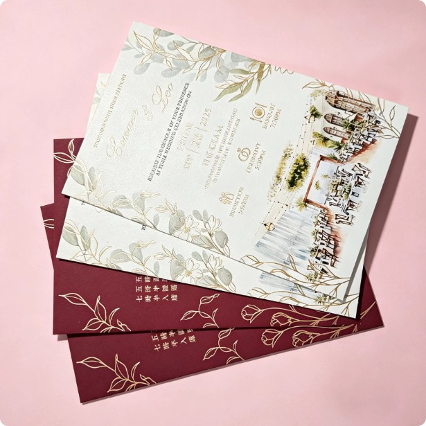
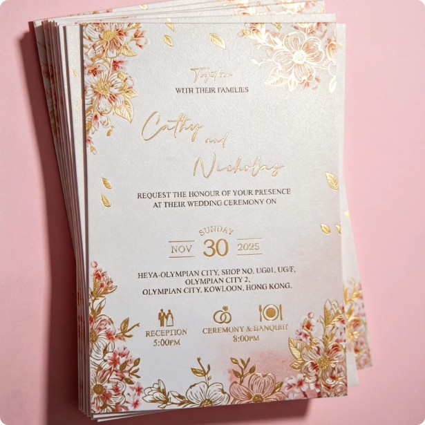
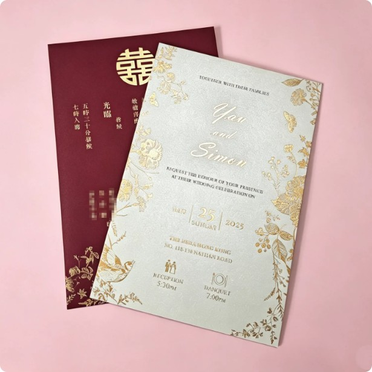
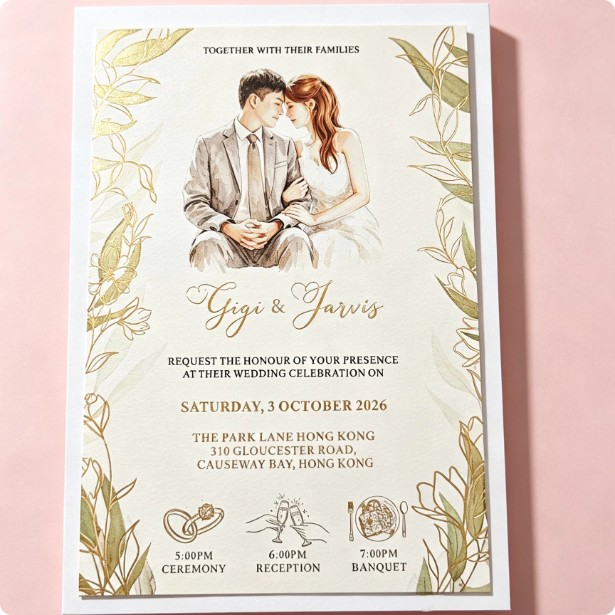
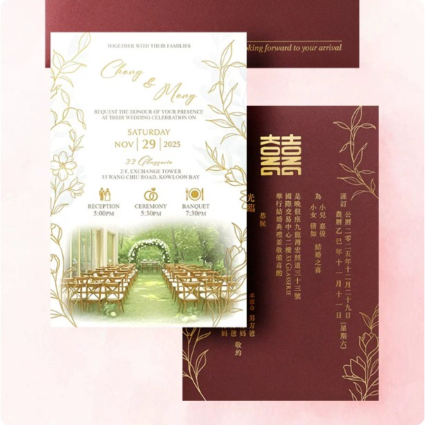
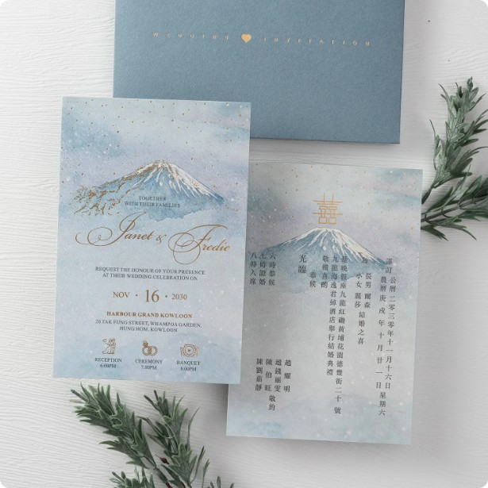
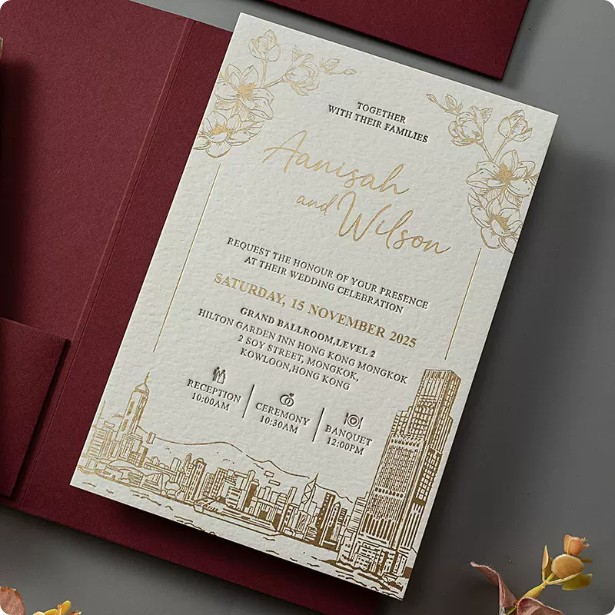
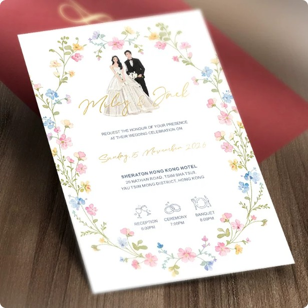
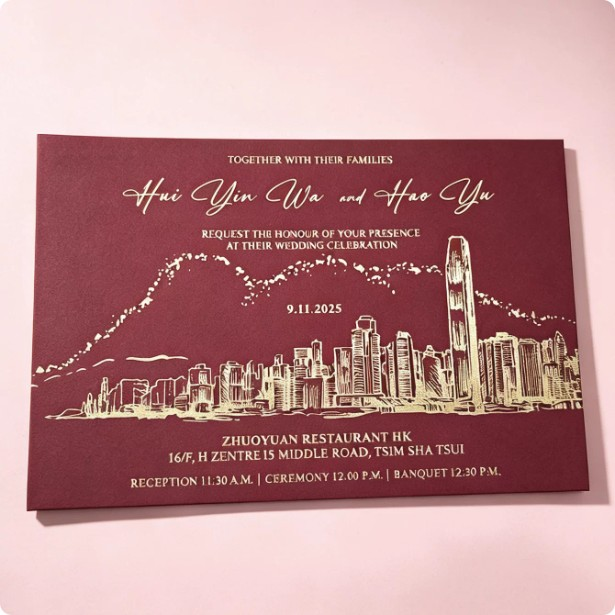
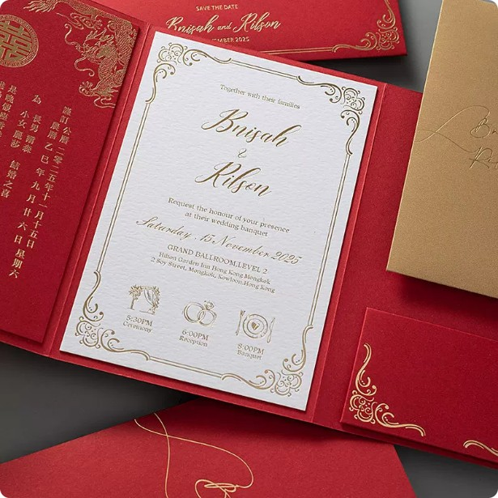

# 喜帖參考原圖紀錄

每次揀「下一款」前先讀 [防重複清單](references/registry.json)，再對照原圖。同款換角度、裁切、信封或商品連結仍算重複。原圖於用戶實體 PC 淘寶商品頁截取；圖片版權屬原權利人，本庫未授予重用授權。

目前已核實收錄 **12 款**。更早歷史參考尚未全面補登。

## WR-0001｜綠葉淡桃花

- 店舖：喜加喜設計
- [淘寶來源](https://item.taobao.com/item.htm?id=678049182777)
- 已參考；四張重畫試稿未通過，未做變奏。下次選款跳過。
- 只取最前面英文婚宴主面；米白底、上方兩側長葉、右側半朵花、底部淡桃重瓣花。

## WR-0002｜The GLAM 場地水彩

- 店舖：喜加喜設計
- [淘寶來源](https://item.taobao.com/item.htm?id=919964342774)
- 已完成參考重畫版及燙金線稿變奏。下次選款跳過。
- 只取最前面英文婚宴主面；灰綠實心葉與獨立金線枝花，底部婚宴場地畫，三欄時間。
- 生成稿地址為示例資料，並非已核實的場地地址。

## WR-0003｜奶白粉花金線

- 店舖：喜加喜設計
- [淘寶來源](https://item.taobao.com/item.htm?id=723132939961)
- 已完成參考重畫版及燙金變奏；共生成5張，採用第2張與第5張。第1張花頭過大；第3張金線刪減過多；第4張的彩印底圖被削弱，按用戶回饋修復。下次選款跳過。
- 最前面英文主帖，Cathy and Nicholas；四角細碎粉花與金線，底部沿邊花帶。

## WR-0004｜米白植物線稿

- 店舖：喜加喜設計
- [淘寶來源](https://item.taobao.com/item.htm?id=944258050100)
- 已完成兩張設計；共生成3張，採用第2張參考版及第3張金線變奏。第1張部分文字與花頭過大。下次選款跳過。
- Wilson and Jennie；主帖右上及左下植物線稿、酒紅日期、三欄時間；不取封套雀鳥裝飾。

## WR-0005｜珠光金色花鳥

- 店舖：喜加喜設計
- [淘寶來源](https://item.taobao.com/item.htm?id=811268024301)
- 已完成兩張設計；共生成3張，採用第2張參考重畫及第3張金線變奏。第1張花頭與字體偏大。下次選款跳過。
- Yau and Simon；兩側不對稱花葉、蝴蝶、左下雀鳥；只取最前方英文主面。

## WR-0006｜水彩新人綠葉

- 店舖：喜加喜設計
- [淘寶來源](https://item.taobao.com/item.htm?id=955342399707)
- 已生成5張純文字重畫試稿，全部未通過比例及構圖相似度；未做變奏。下次選款跳過。
- Gigi & Jarvis；水彩坐姿新人、橄欖綠彩印葉與金線枝花、三欄時間；最前方完整英文主面。

## WR-0007｜33 Glasserie 草地花拱門

- 店舖：喜加喜設計
- [淘寶來源](https://item.taobao.com/item.htm?id=929202669718)
- 已生成4張純文字試稿，未通過位置及圖示驗收；未做變奏。同次任務轉WR-0008。下次選款跳過。
- Chong & Mong；底部座椅與花拱門水彩、兩側金線枝花及淡灰綠彩印葉、三欄時間。

## WR-0008｜淡藍富士山

- 店舖：喜加喜設計
- [淘寶來源](https://item.taobao.com/item.htm?id=1085291229804)
- 完成參考設計稿與金線變奏；富士山共4張，本次連同WR-0007共8張，採用本次第6張及第8張。細字位置仍有偏差，屬概念設計。下次選款跳過。
- Janet & Fredie；富士山、雲霧彩印、碎金山脊與金點；三欄時間。

## WR-0009｜奶白維港線稿

- 店舖：喜加喜設計
- [淘寶來源](https://item.taobao.com/item.htm?id=1063238751863)
- 完成兩張設計稿；共生成4張，採用第3張參考重畫與第4張金線整理。第1張姓名、正文及高樓比例偏差；第2張姓名顏色及標點不符。樓宇細節屬重繪。下次選款跳過。
- Aanisah and Wilson；頂部兩側花枝、底部維港城市線稿及右側高樓；上午三欄時間。

## WR-0010｜彩色碎花新人

- 店舖：喜加喜設計
- [淘寶來源](https://item.taobao.com/item.htm?id=1055809061318)
- 完成兩張設計稿；共生成5張，採用第4張參考重畫及第5張新增金線版。第1張過大、第2張過疏、第3張人像再度過大。花枝細節屬重繪。下次選款跳過。
- Miley & Jack；粉黃藍碎花與綠葉橢圓彩印、上方新人；原圖無裝飾金線，第二張才新增。

## WR-0011｜酒紅獅子山天際線

- 店舖：喜加喜設計
- [淘寶來源](https://item.taobao.com/item.htm?id=733570144681)
- 完成兩張設計稿；本次只生成2張，第1張純文字參考重畫、第2張金線整理。保留酒紅紙底與文字，整理山線碎點及建築密線；樓宇細節屬重繪。下次選款跳過。
- Hui Yin Wa and Hao Yu；酒紅橫版、獅子山碎金輪廓與香港天際線；底部一排時間。

## WR-0012｜白底古典金框

- 店舖：喜加喜設計
- [淘寶來源](https://item.taobao.com/item.htm?id=1059637557377)
- 原圖已記錄，正在重畫。下次選款跳過。
- Bnisah & Rilson；白色壓紋紙、四角卷草雙線金框、底部三欄時間；只取白色英文主面。

## 更新方式

找到合格原圖即存入 `references/originals/` 並加入 `references/registry.json`，保留永久編號、來源、店名、款式特徵及處理狀態；重畫失敗亦保留已參考紀錄。只有用戶明確要求重做舊款時才重用。SHA256 只識別完全相同檔案；同款不同照片須目視比較。GitHub 清單是往後唯一更新來源。
