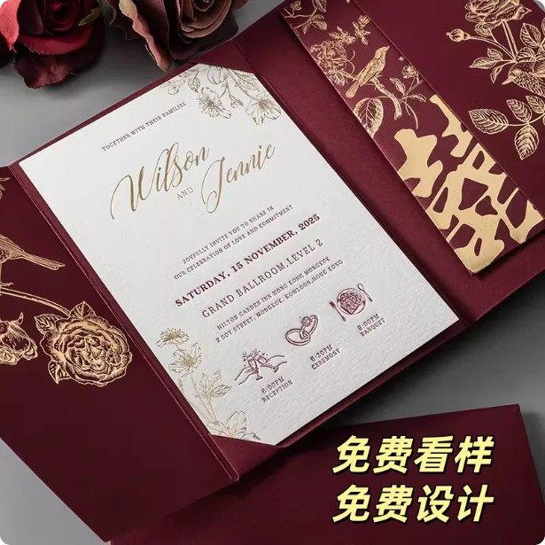

# 喜帖參考原圖紀錄

每次揀「下一款」前先讀 [防重複清單](references/registry.json)，再對照原圖。同款換角度、裁切、信封或商品連結仍算重複。原圖於用戶實體 PC 淘寶商品頁截取；圖片版權屬原權利人，本庫未授予重用授權。

目前已核實收錄 **4 款**。更早歷史參考尚未全面補登。

## WR-0001｜綠葉淡桃花

- 店舖：喜加喜設計
- [淘寶來源](https://item.taobao.com/item.htm?id=678049182777)
- 已參考；四張重畫試稿未通過，未做變奏。下次選款跳過。
- 只取最前面英文婚宴主面；米白底、上方兩側長葉、右側半朵花、底部淡桃重瓣花。

## WR-0002｜The GLAM 場地水彩

- 店舖：喜加喜設計
- [淘寶來源](https://item.taobao.com/item.htm?id=919964342774)
- 已完成參考重畫版及燙金線稿變奏。下次選款跳過。
- 只取最前面英文婚宴主面；灰綠實心葉與獨立金線枝花，底部婚宴場地畫，三欄時間。
- 生成稿地址為示例資料，並非已核實的場地地址。

## WR-0003｜奶白粉花金線

- 店舖：喜加喜設計
- [淘寶來源](https://item.taobao.com/item.htm?id=723132939961)
- 已完成參考重畫版及燙金變奏；共生成5張，採用第2張與第5張。第1張花頭過大；第3張金線刪減過多；第4張的彩印底圖被削弱，按用戶回饋修復。下次選款跳過。
- 最前面英文主帖，Cathy and Nicholas；四角細碎粉花與金線，底部沿邊花帶。

## WR-0004｜米白植物線稿

- 店舖：喜加喜設計
- [淘寶來源](https://item.taobao.com/item.htm?id=944258050100)
- 已完成兩張設計；共生成3張，採用第2張參考版及第3張金線變奏。第1張部分文字與花頭過大。下次選款跳過。
- Wilson and Jennie；主帖右上及左下植物線稿、酒紅日期、三欄時間；不取封套雀鳥裝飾。

## 更新方式

找到合格原圖即存入 `references/originals/` 並加入 `references/registry.json`，保留永久編號、來源、店名、款式特徵及處理狀態；重畫失敗亦保留已參考紀錄。只有用戶明確要求重做舊款時才重用。SHA256 只識別完全相同檔案；同款不同照片須目視比較。GitHub 清單是往後唯一更新來源。
